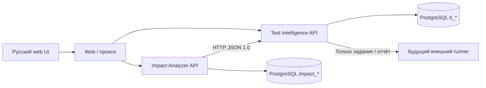

# Архитектура

Одна PostgreSQL-инстанция; таблицы разделены префиксами, ревизия 0001 создаёт impact и аудит, 0002 — intelligence. Бизнес-сущности нормализованы: версии/объекты/рёбра, анализы/затронутые объекты, каталог/покрытие, прогоны/результаты/дефекты, приоритеты/планы/задания. JSON-поля — неизменяемые входные снимки, объяснения и параметры. Композитные FK рёбер не допускают ссылки на узлы другой версии.

Сервисы независимы на уровне API. Test Intelligence импортирует `ImpactPackage`, не обращается к `impact_*`. Web выполняет только запросы к публичным API. Доставка не входит в транзакцию анализа: сетевой отказ не уничтожает отчёт; пользователь может повторить отправку по ID. Гарантия exactly-once не заявляется; повторный идентичный пакет идемпотентен.

Завершение транзакции происходит до ответа HTTP, через dependency scope=function. При ошибках проверки, FK или уникальности не остаётся частичной версии/истории/плана. Уникальные ключи обеспечивают защиту конкурирующих вставок; при гонке один запрос может получить 409 и должен перечитать сохранённое состояние. Синхронный расчёт имеет ограниченный объём; распределённая очередь не используется.

Роли: analyst — импорт, сравнение, расчёт, обычный каталог и неподтверждённые привязки; expert — эти возможности плюс подтверждение связей/планов, веса, обучение, исключения critical и экспорт заданий; runner — просмотр и импорт внешних результатов. Проверки действуют на сервере. Пароли задаются только через env, отсутствующий пароль отключает роль. Вход через HTTP Basic — локальный MVP, для общего доступа необходим HTTPS reverse proxy. Ролевые учётные записи общие; для индивидуального аудита понадобится персональная аутентификация.

Процессы не являются сохранённым состоянием среды: после восстановления нужно запустить Compose или локальные uvicorn. PostgreSQL volume сохраняет результаты. Для резервного копирования используйте `pg_dump`; восстановление бизнес-проекта в иной среде требует отдельной проверки.

Ревизия 0003 добавляет `impact_projects`, `impact_uploads` и `impact_upload_analyses`. Исходные файлы хранятся в PostgreSQL BYTEA, история и отчёты — отдельными записями. Первичный анализ допускает NULL base_id и явно маркируется mode=full. Подробнее — uploads.md. Сохранение файла и нормализованной версии атомарно.

Ревизия 0004 добавляет ti_ai_suites (снимки предложений, подтверждений и результатов), ti_ai_evidence (PNG BYTEA) и отдельную demo_orders для учебного стенда. Генерация через OpenAI-совместимый HTTPS API проверяется схемой contracts/ai-suggestion-1.0.schema.json. Экспертное подтверждение сохраняет новые тесты и покрытие; учебный исполнитель записывает фактическую историю и дефекты. Произвольный код модели не выполняется.
